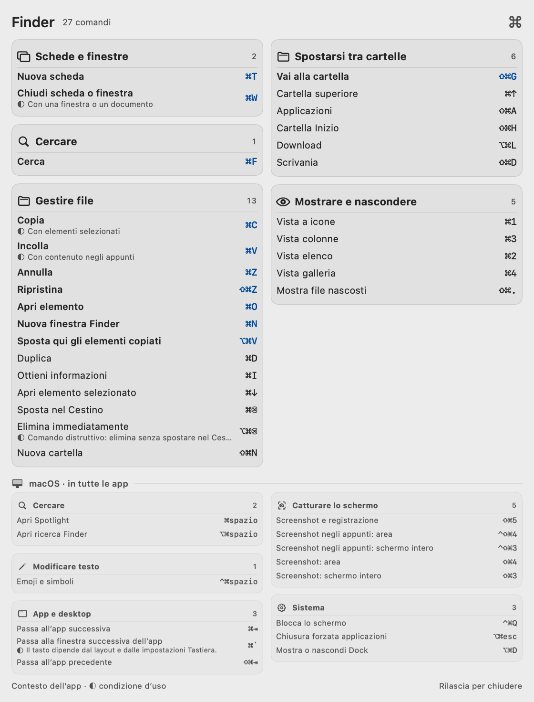
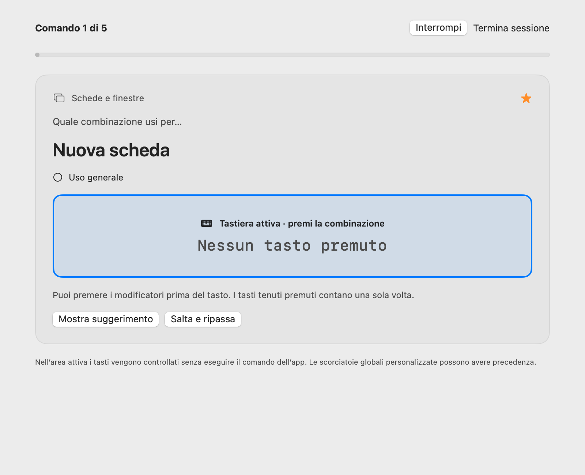

# Scorciatoie

Impara le combinazioni del Mac mentre lavori. Tieni premuto un modificatore per vedere cosa puoi fare nell’app attiva; apri Studio per esplorare il catalogo ed esercitarti.

[Scarica per Mac](https://github.com/giuucmp/scorciatoie/releases/download/v0.3.0/Scorciatoie-0.3.0-universal.dmg) · [Sito](https://giuucmp.github.io/scorciatoie/it/) · [English](README.md) · [Contribuisci](CONTRIBUTING.md)

App macOS nativa · macOS 13+ · Apple silicon e Intel · Italiano e inglese · Licenza MIT



## Installazione

1. Scarica il DMG dai [rilasci su GitHub](https://github.com/giuucmp/scorciatoie/releases/tag/v0.3.0), aprilo e trascina **Scorciatoie** in **Applicazioni**.
2. Apri l’app. Questa versione non è firmata con Developer ID né notarizzata da Apple. Se macOS blocca il primo avvio, vai in **Impostazioni di Sistema → Privacy e sicurezza → Apri comunque** e conferma. Approva solo la copia scaricata dal rilascio di questo progetto.
3. Abilita Scorciatoie in **Impostazioni di Sistema → Privacy e sicurezza → Accessibilità**. L’icona Comando resta nella barra dei menu.

Non serve il permesso Registrazione schermo. Puoi revocare Accessibilità in qualsiasi momento. Dopo un aggiornamento, macOS potrebbe chiederti di abilitarla di nuovo.

## Uso

- Tieni premuto **Comando, Opzione, Ctrl, Maiuscole o Fn**. Dopo una breve attesa, un pannello consultivo mostra le scorciatoie dell’app attiva.
- Aggiungi modificatori per restringere i risultati. I gruppi descrivono uno scopo, come cercare, modificare o gestire finestre. Le scorciatoie macOS occupano una fascia separata e più piccola.
- Rilascia i modificatori per chiudere il pannello. Non diventa mai la finestra attiva, lascia passare i clic e non intercetta i comandi della tua app. Digitare prima dell’attesa annulla l’apertura.
- Fai clic sull’icona nella barra dei menu per le impostazioni. Dal suo menu contestuale puoi aprire **Studio**, mettere in pausa o uscire.
- In Studio, cerca nel catalogo, salva i preferiti e nascondi le azioni che non usi. **Nascoste** permette di recuperarle. Nelle impostazioni puoi regolare testo, aspetto, posizione e modificatori di richiamo.
- Scegli **Italiano**, **Inglese** o lingua **Automatica**. Un titolo live sconosciuto fornito da un’altra app resta nella lingua originale se non è presente nel catalogo delle traduzioni.

Liquid Glass nativo è disponibile da macOS 26. Sui sistemi precedenti viene usato un materiale traslucido. Sono rispettate le impostazioni Riduci trasparenza e Aumenta contrasto.

## Esercizi in Studio

Scegli app e filtri, apri **Esercizi**, attiva il campo dedicato e digita la combinazione o la sequenza richiesta. Rivedi gli errori e riprova. I tasti vengono acquisiti localmente solo quando l’esercizio ha il focus; le combinazioni riservate al sistema sono escluse dalla pratica digitata. Preferiti e progressi restano sul Mac.



## Copertura e limiti

Scorciatoie unisce tre fonti:

- Menu accessibili dell’app attiva.
- Cataloghi offline tratti da documentazione pubblica.
- Assegnazioni personali e dichiarazioni delle estensioni supportate per VS Code/Cursor, oltre ai profili CLI supportati.

**Un’app riconosciuta non equivale a una copertura completa delle sue scorciatoie.** Alcuni menu si caricano solo dopo l’apertura; Scorciatoie non li apre di nascosto. Le voci conservano fonte e contesto quando disponibili. Scansioni parziali e condizioni incerte vengono segnalate. Il catalogo attuale è descritto nel [rapporto di copertura](docs/coverage.json).

Contesti degli editor e condizioni delle estensioni vengono interpretati solo quando supportati. Le condizioni non risolte restano sconosciute. Le scorciatoie macOS personalizzate non vengono riconciliate automaticamente. Sono inclusi i comandi dell’app browser; le scorciatoie dei siti web restano fuori da questo ambito.

Il profilo **Safari Sviluppo / Web Inspector** si seleziona esplicitamente in Studio e può essere assegnato facoltativamente con **Usa nel pannello**. Web Inspector non viene rilevato automaticamente.

I profili del terminale si selezionano esplicitamente in Studio. Scorciatoie non legge il contenuto del terminale per indovinare il programma in uso.

## Privacy

Nessun account, telemetria o richiesta di rete dall’app. Vengono letti i menu accessibili e il contesto strutturale, oltre ai file di assegnazione e alle dichiarazioni delle estensioni supportate. Non vengono registrati il testo o le combinazioni che digiti nelle altre app. Preferenze, scorciatoie importate, preferiti, azioni nascoste e progressi degli esercizi sono salvati localmente.

Il permesso Accessibilità serve per leggere i menu e rilevare i modificatori. Registrazione schermo non viene usata.

## Importare scorciatoie personali

Dal menu contestuale nella barra dei menu, scegli **Importa scorciatoie personali…** e seleziona un array JSON:

```json
[
  {
    "profile": "finder",
    "title": "Azione personale",
    "keys": "cmd+alt+k",
    "category": "File",
    "context": "Solo nel contesto indicato"
  }
]
```

L’importazione documenta un’assegnazione già configurata: non assegna i tasti in un’altra app. Gli ID dei profili sono elencati in [docs/coverage.json](docs/coverage.json); `system` rende una voce globale. Separa i passaggi di una sequenza con uno spazio, per esempio `cmd+k cmd+s`.

## Compilare in locale

Per compilare servono Swift 6 o successivo e l’SDK macOS 26, fornito da Xcode 26 o dagli strumenti a riga di comando equivalenti. La versione minima di esecuzione resta macOS 13. L’app non usa framework di terze parti a runtime.

```sh
git clone https://github.com/giuucmp/scorciatoie.git
cd scorciatoie
./scripts/check.sh
python3 scripts/test_key_parser.py
python3 scripts/test_category_classifier.py
./scripts/build-app.sh
```

L’output predefinito è `dist/Scorciatoie.app`. Per compilare entrambe le architetture Apple silicon e Intel e creare il DMG:

```sh
UNIVERSAL=1 ./scripts/build-app.sh
./scripts/package-dmg.sh
```

Lo script crea il bundle dell’app e lo firma ad hoc per l’uso locale. Non si tratta di una firma Developer ID né di notarizzazione. Una copia compilata localmente può richiedere una nuova autorizzazione Accessibilità.

Su macOS 26+, `./scripts/check-glass.sh` verifica il rendering sintetico fuori schermo con Metal. Richiede accesso alla GPU. Gli strumenti di generazione del catalogo usano Python e BeautifulSoup; l’app distribuita contiene solo i dati del catalogo risultante.

Per rigenerare o visualizzare in locale il sito statico basta Python 3:

```sh
python3 site/build.py
python3 -m http.server 8765 --directory site
```

Apri `http://localhost:8765/` oppure `http://localhost:8765/it/`.

## Contribuire

Sono benvenuti segnalazioni di problemi, correzioni verificate delle scorciatoie e traduzioni. Leggi [CONTRIBUTING.md](CONTRIBUTING.md) prima di aprire una pull request. Per i problemi relativi alle combinazioni, indica le versioni dell’app e di macOS.

Distribuita con [licenza MIT](LICENSE). Apple, macOS e gli altri nomi di prodotto appartengono ai rispettivi titolari; questo progetto è indipendente.
