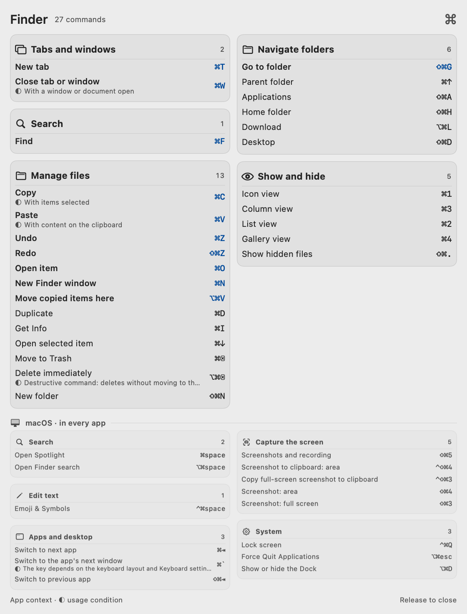
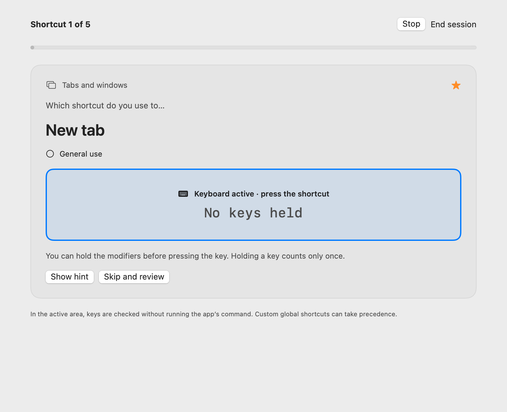

# Shortcuts

Learn your Mac’s shortcuts as you work. Hold a modifier to see what you can do in the active app; open Studio to explore and practice.

[Download for Mac](https://github.com/giuucmp/shortcuts/releases/download/v0.3.2/Shortcuts-0.3.2-universal.dmg) · [Website](https://giuucmp.github.io/shortcuts/) · [Italiano](README.it.md) · [Contribute](CONTRIBUTING.md)

Native macOS app · macOS 13+ · Apple silicon and Intel · English and Italian · MIT license



## Install

1. Download the DMG from [GitHub Releases](https://github.com/giuucmp/shortcuts/releases/tag/v0.3.2), open it, and drag **Shortcuts** into **Applications**.
2. Open the app. This release is not Developer ID signed or Apple-notarized. If macOS blocks the first opening, go to **System Settings → Privacy & Security → Open Anyway** and confirm. Only approve the copy you downloaded from this project’s release.
3. Enable Shortcuts in **System Settings → Privacy & Security → Accessibility**. Its Command icon lives in the menu bar.

No Screen Recording permission is required. You can revoke Accessibility access at any time. macOS may ask you to re-enable access after an update.

## Use

- Hold **Command, Option, Control, Shift or Fn**. After a short delay, a passive panel shows shortcuts for the active app.
- Add modifiers to narrow the results. Groups describe a purpose, such as finding, editing or managing windows. macOS shortcuts occupy a separate, smaller band.
- Release the modifiers to close the panel. It never becomes the active window, lets clicks pass through and leaves your app’s shortcuts alone. Normal typing before the delay cancels the panel’s opening.
- Click the menu-bar icon for settings. Use its context menu to open **Studio**, pause or quit.
- In Studio, search the catalog, save favorites and hide unwanted actions. **Hidden** lets you restore them. Adjust text size, appearance, panel position and activation modifiers in settings.
- Choose **English**, **Italian**, or **Automatic** language. An unfamiliar live title supplied by another app stays in its original language if the translation catalog does not contain it.

Native Liquid Glass is used on macOS 26 and later. Earlier systems use a translucent fallback. Reduce Transparency and Increase Contrast settings are respected.

## Practice in Studio

Choose an app and filters, open **Practice**, focus the exercise and enter the requested chord or sequence. Review errors and try them again. Input is captured locally only while the exercise has focus; OS-reserved combinations are excluded from typing exercises. Favorites and practice progress stay on your Mac.



## Coverage and limits

Shortcuts combines three sources:

- Accessible menus from the active app.
- Documented offline shortcut catalogs.
- Supported personal bindings and extension declarations for VS Code/Cursor, plus supported CLI profiles.

**A recognized app does not mean complete shortcut coverage.** Some menus load only after opening them; Shortcuts does not open them secretly. Catalog entries retain their source and context when available. Partial menu scans and uncertain conditions are indicated. See [the coverage report](docs/coverage.json) for the current catalog.

Editor contexts and extension conditions are interpreted only when supported. Unresolved conditions remain unknown. Custom macOS system shortcuts are not automatically reconciled. Browser app commands are covered; shortcuts inside websites are outside that scope.

The **Safari Develop / Web Inspector** profile is selected explicitly in Studio and can optionally be assigned with **Use in panel**. Web Inspector is not detected automatically.

Terminal profiles are selected explicitly in Studio. Shortcuts does not read terminal contents to guess which program you are using.

## Privacy

No account, telemetry or network requests from the app. It reads accessible menu information and structural context, plus supported binding files and extension declarations. It does not record the text or shortcuts you type in other apps. Preferences, imported shortcuts, favorites, hidden actions and practice progress are stored locally.

Accessibility permission enables menu reading and modifier detection. Screen Recording is not used.

## Import your shortcuts

From the menu-bar context menu, choose **Import personal shortcuts…** and select a JSON array:

```json
[
  {
    "profile": "finder",
    "title": "My action",
    "keys": "cmd+alt+k",
    "category": "File",
    "context": "Only in the specified context"
  }
]
```

This documents a binding you have already configured; it does not assign keys in another app. Profile IDs are listed in [docs/coverage.json](docs/coverage.json); `system` makes an entry global. Separate sequence steps with a space, such as `cmd+k cmd+s`.

## Build locally

Building requires Swift 6 or later and the macOS 26 SDK, supplied by Xcode 26 or equivalent Command Line Tools. The deployment target remains macOS 13. The app has no third-party runtime frameworks.

```sh
git clone https://github.com/giuucmp/shortcuts.git
cd shortcuts
./scripts/check.sh
python3 scripts/test_key_parser.py
python3 scripts/test_category_classifier.py
./Tests/PackagedResourcesChecks/run.sh
./scripts/build-app.sh
```

The default output is `dist/Shortcuts.app`. To build both Apple silicon and Intel architectures and package the DMG:

```sh
UNIVERSAL=1 ./scripts/build-app.sh
./scripts/package-dmg.sh
```

The build script assembles an app bundle and signs it ad hoc for local use. This is not Developer ID signing or notarization. A locally built copy may require a fresh Accessibility approval.

On macOS 26+, `./scripts/check-glass.sh` checks synthetic offscreen rendering with Metal. GPU access is required. Catalog-building tools use Python and BeautifulSoup; the distributed app only includes the resulting catalog data.

The static website needs only Python 3 to regenerate or preview:

```sh
python3 site/build.py
python3 -m http.server 8765 --directory site
```

Open `http://localhost:8765/` or `http://localhost:8765/it/`.

## Contribute

Bug reports, verified shortcut corrections and translations are welcome. Read [CONTRIBUTING.md](CONTRIBUTING.md) before opening a pull request. Please include the app and macOS versions when reporting a shortcut problem.

Released under the [MIT license](LICENSE). Apple, macOS and other product names belong to their respective owners; this project is independent.
